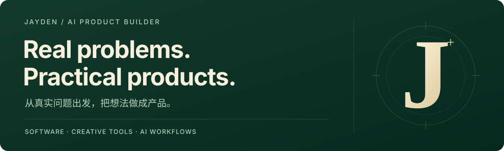
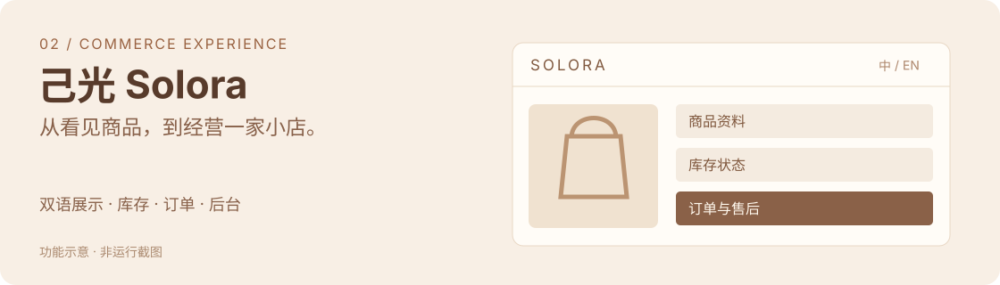

# Hi, I'm Jayden 👋

**我把创作和经营里的具体问题，做成软件与可复用的 AI 工作流。**

从自己的使用场景出发，梳理需求、设计操作过程，结合 AI 推进实现和验证，再把重复任务整理成方法。这是我持续在做的事。

[软件作品](#selected-work) · [我整理的工作流](#my-workflow) · [我的做法](#how-i-work)

## Selected work · 软件作品

### 01 / 一人片场 · SoloStudio

**让一个人的创作，从稿件、制作方案到实际素材接得起来。**

我围绕多系列创作中的版本和交接问题，推进了作品工作台与配套的阶段工作流。它把候选、确认稿和后续材料放回同一份作品上下文中。

**展示重点**　内容工作台 · 版本接续 · 工作流编排  
**当前阶段**　本地持续迭代，已有作品、稿件、对话与素材组织能力。

[阅读完整案例 →](projects/solostudio/README.md)

### 02 / 己光 · Solora

**把面向顾客的商品展示，和经营者每天要做的事接起来。**

从中英双语商品页，到商品维护、库存、订单和售后，我关注一套商城在展示之后，如何继续被经营者使用和维护。

**展示重点**　双语商城 · 经营后台 · 业务状态一致性  
**当前阶段**　已有部署记录；购买与退款采用测试支付，尚未启用正式收款。

[阅读完整案例 →](projects/solora/README.md)

### 03 / 拾光 · Daybound

**把照片整理成可以编辑、逐页确认的画册与 PDF。**

我围绕“照片到成册”设计使用过程，保留调整文字、排序和版面的空间，让生成结果经过查看与确认，再衔接后续交付。

**展示重点**　生成式 AI 体验 · 编辑与确认 · 数字交付物  
**当前阶段**　本地迭代，有多语言配文和 PDF 检查记录；实物打样及完整履约仍待验证。

[阅读完整案例 →](projects/daybound/README.md)

*以上配图为功能示意，不是产品运行截图。各案例按实际阶段说明能力与边界。*

## My workflow · 我整理的制片工作流

在一人片场中，我把自己的制作需求整理为 **六个阶段 + 统筹入口 + 横向审核**，形成一套由 8 项 Skill 配合的工作流。

- **职责清楚**：每一步知道要接收什么、交付什么。
- **版本接得上**：后续工作沿用已确认材料，保留人的定稿与选择。
- **按任务组合**：只写稿就完成写稿，已有材料就从需要的阶段继续。

我的贡献是需求、职责、输入输出与接续方式的整理和迭代，结合 AI 辅助编写。模型、生成工具、渲染引擎和第三方素材按各自来源说明。

[查看 8 项职责与一个独立示例 →](workflows/README.md)

## How I work · 我的做法

| 从哪里开始 | 我具体关注什么 |
| --- | --- |
| 一个真实使用问题 | 谁要在什么场景下完成哪件事 |
| 一条能走通的过程 | 输入、编辑、确认、保存，以及失败后怎样继续 |
| 一轮可判断的迭代 | 实际做到了什么、检查过什么、还缺什么 |
| 一份可接续的结果 | 有效版本、本人选择、必要材料和下一步 |

我用这些作品展示自己的产品判断、交互设计、AI 辅助交付和持续迭代能力。

**I build practical software and reusable AI workflows, starting from everyday problems.**
