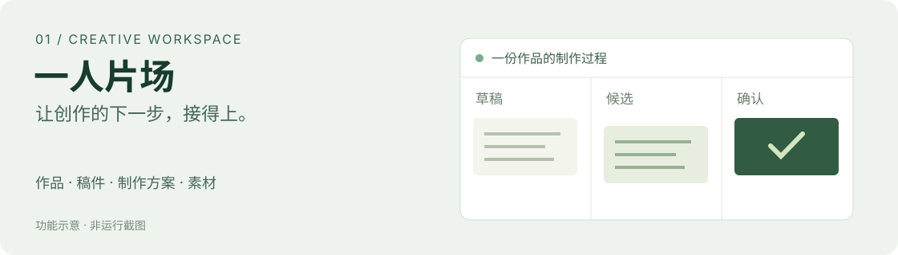
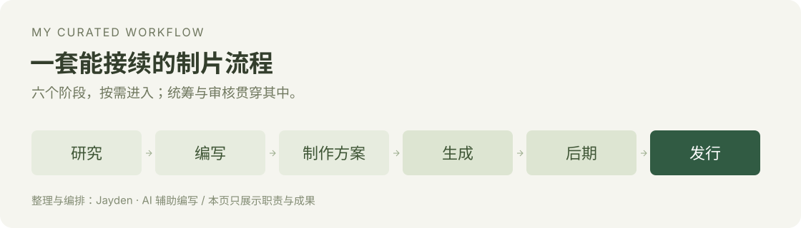

# Hi, I'm Jayden.

**I turn everyday creative and business tasks into practical software and reusable AI workflows.**

我从自己的使用场景出发，把创作与经营中的具体问题，做成软件和可复用的工作流。

## Selected work · 精选作品

<table role="presentation">
<tr>
<td width="50%" valign="top">

<h3>SoloStudio · 一人片场</h3>

A local workspace connecting scripts, production plans and creative assets. 连接稿件、制作方案与素材的创作工作台。

Local iteration · Version continuity

<a href="projects/solostudio/README.md">Explore SoloStudio →</a>

</td>
<td width="50%" valign="top">

<h3>Solora · 己光</h3>

A bilingual storefront with tools for products, inventory and orders. 双语商品展示与经营后台。

Deployed · Payments and refunds in test mode

<a href="projects/solora/README.md">Explore Solora →</a>

</td>
</tr>
<tr>
<td width="50%" valign="top">

<h3>Daybound · 拾光</h3>

Turn photos into editable books and PDFs, reviewed page by page. 把照片整理成可编辑、可逐页确认的画册。

Local iteration · Physical fulfillment unverified

<a href="projects/daybound/README.md">Explore Daybound →</a>

</td>
<td width="50%" valign="top">

<h3>AI Workflows · 制片工作流</h3>

Six production stages I organized, supported by coordination and review. 本人整理的六阶段流程，配合统筹与审核。

Personally curated · Six stages + coordination / review

<a href="workflows/README.md">Explore AI Workflows →</a>

</td>
</tr>
</table>

[All public work →](projects/README.md) · 全部公开作品与工作流

Concept diagrams, not live screenshots. See each case for current scope and status. 配图为功能示意，实际能力与当前阶段见各案例。

## How I build · 我的做法

- **Start with a real task.** Define who needs to do what, and in which situation. 从具体任务出发。
- **Work through the whole flow.** Connect input, editing, confirmation, saving and recovery. 把流程做顺。
- **Make the next step clear.** Record what works, the current version and what remains. 留下可接续的结果。

I lead product requirements, interaction decisions and workflow design, with AI assisting design, development and iteration. Third-party tools and materials are credited; installed skills are not presented as my own work.

我主导产品需求、交互取舍与工作流整理，结合 AI 推进实现和迭代；第三方工具与素材按来源说明。
