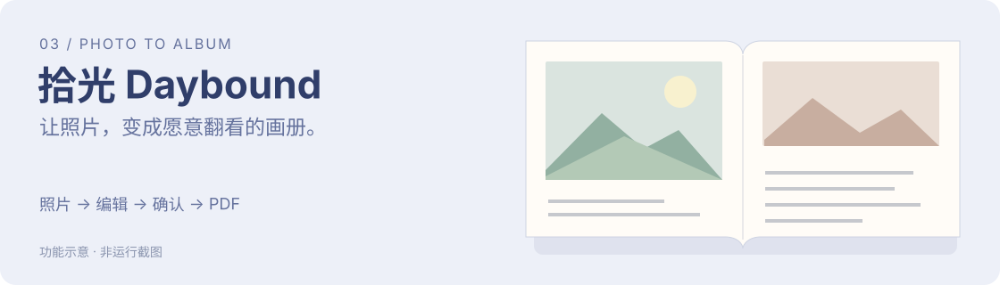

# 拾光 · Daybound

**把照片整理成可编辑、可逐页确认的画册与 PDF。**

*功能示意，非运行截图。*

## 从哪个问题开始

照片保存下来后，还需要挑选、排序、配文和排版，才能变成愿意翻看的画册。生成之后，也需要让用户实际查看、修改和确认。

Daybound 围绕“照片到成册”的使用任务组织工具。

## 一条使用路径

**选择授权照片 → 确认画册类型 → 调整文字、顺序和版面 → 查看实际 PDF → 逐页确认 → 按启用范围衔接报价与订单。**

## 当前可以展示的能力

| 环节 | 用户可以完成什么 |
| --- | --- |
| 整理 | 选择照片、画册类型与顺序 |
| 编辑 | 调整文字和版面，使用 AI 辅助配文 |
| 成册 | 生成多语言画册与实际 PDF |
| 确认 | 逐页查看，将文件版本与后续订单衔接 |

## 我做的产品选择

**生成后继续给用户编辑空间。** 用户能调整结果，再查看实际文件。

**最终文件需要逐页确认。** 用真实 PDF 作为交付依据，让确认内容对应到具体版本。

**数字制作与实物交付分阶段验证。** 配文和 PDF 有各自检查范围；印厂打样、收款和履约需要另外形成真实记录。

## 贡献与工具

我主导具体需求、使用过程和交付边界的梳理，结合 AI 辅助设计、开发和迭代。第三方模型、组件和工具保留各自来源；这里按具体产品工作说明本人贡献。

## 当前阶段

已形成本地迭代能力，有多语言配文和实际 PDF 检查记录。2026-11-04 的商品及下单改动仍为本地未发布版本；真实印厂打样、正式收款及完整实物履约尚未验证。

本案例使用功能示意，不展示私人照片、真实订单、供应商或经营资料。

[← 返回个人主页](../../README.md)
