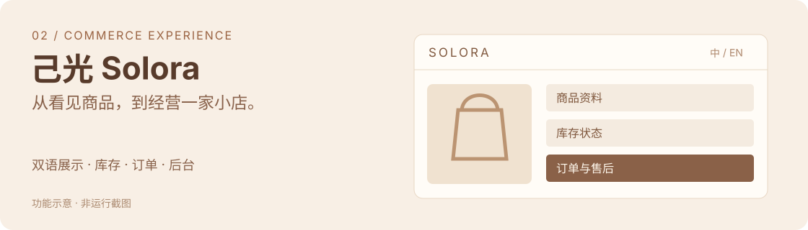

# 己光 · Solora

**让顾客看懂商品，让经营者维护好一家小店。**

*功能示意，非运行截图。*

## 从哪个问题开始

商品页需要表达品牌和商品价值，经营后台需要处理信息、规格、库存和订单。这两部分共同决定一套小型商城能否持续使用。

Solora 围绕顾客与经营者这两条路径，衔接双语展示和日常维护。

## 两条使用路径

| 访客与顾客 | 经营者 |
| --- | --- |
| 浏览商品、切换语言 | 维护商品资料和规格 |
| 选择规格、进入下单过程 | 管理上架状态和库存 |
| 查看相应订单状态 | 处理订单和退款相关事项 |

## 当前可以展示的能力

- 中英双语商品展示与购物过程。
- 商品、规格及上架状态维护。
- 库存、订单与退款相关管理。
- 配套经营后台及维护功能。

## 我做的产品选择

**前台与后台围绕同一份业务状态工作。** 商品变化、库存状态与订单过程需要相互对应，页面展示跟随实际启用的条件。

**让经营者能继续维护。** 商品资料和状态的日常修改进入后台，减少每次更新都依赖改页面的负担。

**把测试状态说清楚。** 支付相关流程按实际启用环境显示，案例采用已有验证范围说明完成程度。

## 贡献与工具

我主导具体需求、使用过程和交付边界的梳理，结合 AI 辅助设计、开发和迭代。第三方模型、组件和工具保留各自来源；这里按具体产品工作说明本人贡献。

## 当前阶段

已有部署记录，2026-11-05 项目资料确定 v1.0 基线。购买与退款仍采用测试支付，尚未启用正式收款。测试订单和检查记录不作为实际销售、营业额或发货成果。

本案例展示产品结构与软件能力，不包含经营数据、内部配置或支付资料。

[← 返回个人主页](../../README.md)
