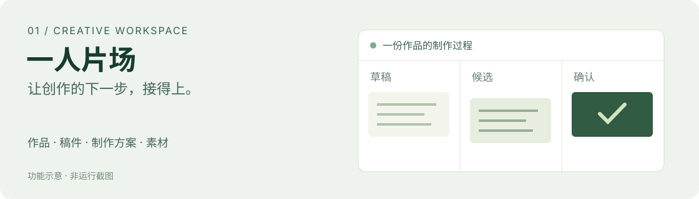

# 一人片场 · SoloStudio

**一个人的创作工作台，让稿件、制作方案和素材接得起来。**

*功能示意，非运行截图。*

## 从哪个问题开始

多个内容系列同时推进时，创作容易卡在衔接上：这份稿是不是当前版本？制作方案对应哪份稿？手里的素材支持哪一版？下一轮该从哪里继续？

我围绕自己的这些需求，推进了本地工作台，以及一套配合它使用的阶段工作流。

## 一条使用路径

**选择系列与作品 → 写稿或继续当前阶段 → 比较候选 → 确认有效版本 → 接续方案与素材 → 整理后期和成片记录。**

用户可以直接进入需要的阶段。每份作品保留自己的资料、版本与讨论上下文。

## 当前可以展示的能力

| 使用任务 | 软件提供的组织方式 |
| --- | --- |
| 同时推进多个系列 | 按系列与作品归位材料 |
| 比较不同写法 | 保存候选和确认版本 |
| 把稿件推进到制作 | 连接制作方案、参考与实际素材 |
| 下一轮继续工作 | 保留作品对话、资料记录与阶段状态 |

## 我做的产品选择

**把“当前采用哪一份”做成明确状态。** 后续工作应采用已确认材料，保留候选便于比较；不同版本之间的关系需要能回看。

**让阶段围绕实际任务组合。** 研究、编写、方案、生成和后期各有职责；用户可以从已有成果接着做。

**把决定留在人手上。** 定稿、选片与发布由人作选择。工具负责组织材料与接续。

## 贡献与工具

我主导具体需求、使用过程和交付边界的梳理，结合 AI 辅助设计、开发和迭代。第三方模型、组件和工具保留各自来源；这里按具体产品工作说明本人贡献。

## 配套工作流

我围绕这些创作需求整理了 8 项协作职责：一个统筹入口、六个阶段与一项横向审核。它们是一套完整工作流，不按 8 个独立软件宣传。

[查看工作流职责与独立示例 →](../../workflows/README.md)

## 当前阶段

本地持续迭代，已有作品、版本、对话和素材组织能力；尚未作为公网多人服务完成交付验收。材料组织能力与实际出片效果分别评价，最终质量依具体作品判断。

项目状态依据 2026-11-05 核对的现行资料整理。

[← 返回个人主页](../../README.md)
