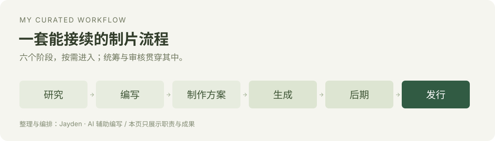

# 我整理的 AI 制片工作流

**让每一步都有明确输入、产物和接续方式。**

## 为什么整理这套方法

在自己的创作项目中，反复出现的问题是阶段衔接：研究资料没有进入剧本，方案使用了旧稿，素材与选定版本对不上，下一轮又要从头解释。

我把原有制作经验与任务要求整理、重构成一套 8 项 Skill 配合的工作流，结合 AI 辅助编写和迭代。

## 8 项职责怎样配合

| 职责 | 输入 | 主要输出 |
| --- | --- | --- |
| `solo-studio` 制片统筹 | 本轮目标、当前作品状态 | 当前应进入的阶段与接续事项 |
| `studio-research` 研究 | 主题、参考与待核问题 | 可用资料及仍未知的部分 |
| `studio-write` 编写 | 有效设定、素材和写作要求 | 剧本、口播或候选稿 |
| `studio-plan` 制作方案 | 有效稿与制作条件 | 分镜、表演、摄影与制作方案 |
| `studio-generate` 生成执行 | 已确认方案与授权 | 实际素材、任务及候选记录 |
| `studio-edit` 后期 | 有效方案和实际素材 | 剪辑、字幕、声音与检查结果 |
| `studio-publish` 发行准备 | 定稿、成片或真实反馈 | 标题封面、发布准备与复盘 |
| `studio-audit` 横向审核 | 明确范围和已有证据 | 问题位置、依据与返工建议 |

六个制作阶段可以按任务组合，统筹入口负责接续，审核按需介入。实际生成和发布按本轮授权与可用工具执行。

## 我整理了什么

**职责边界**：明确每一步负责哪类问题、应该交付什么。

**输入输出**：让后续阶段取得需要的材料和有效版本。

**确认与接续**：保留定稿、选片和投入的人工决定，下一轮知道当前采用哪一份。

这些是本人整理和重构的工作方式。模型、生成工具、渲染引擎、已有理论和第三方素材各按来源说明；安装的第三方 Skill 不计作本人作品。

## 一个独立的文字示例

[查看“桌边的一株绿植”如何交接 →](examples/plant-story.md)

这是为展示职责衔接新写的虚构示例，只包含文字产物，没有调用生成工具或制作成片。

[← 返回个人主页](../README.md)
